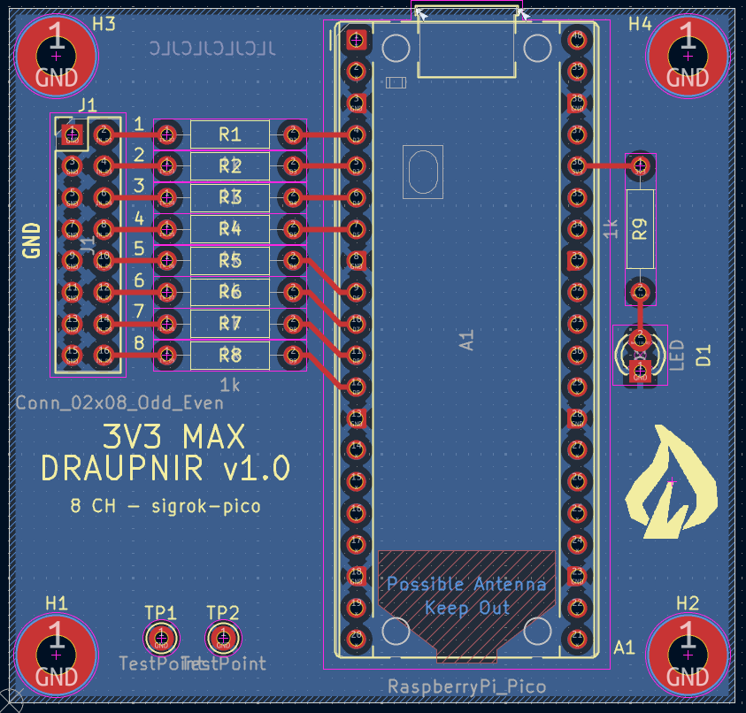
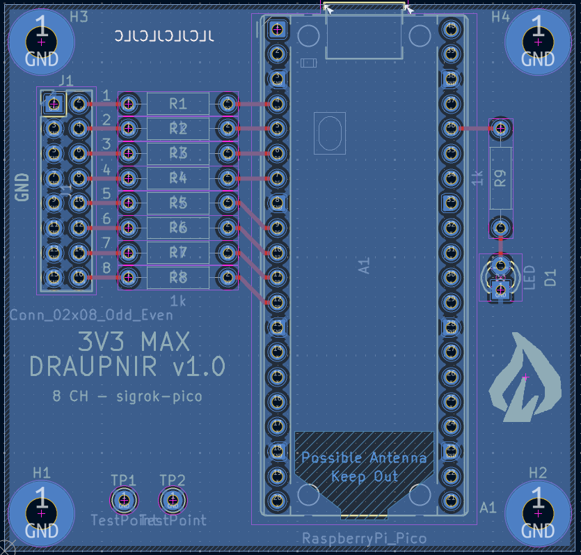
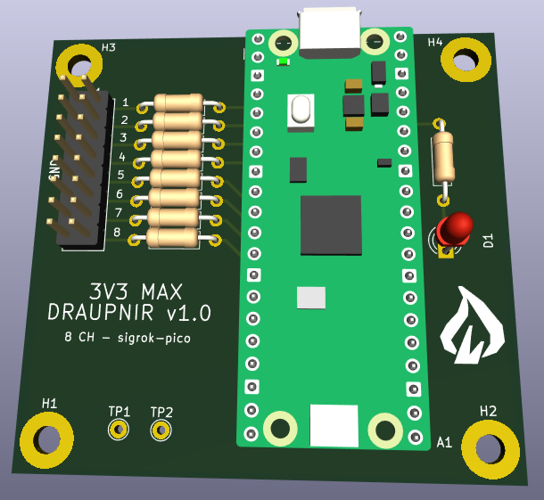

# Draupnir

Analizador lógico de 8 canales: una Raspberry Pi Pico con el firmware libre [sigrok-pico](https://github.com/pico-coder/sigrok-pico) y PulseView en el PC, sobre una PCB propia con protección de entradas. **La v1 es solo para señales de 3,3 V.** El buffer que acepta 5 V (74LVC245) llega en la v2.

**EDA:** KiCad 10, con la biblioteca Forja de [Akmon](https://github.com/BMarquinaProjects/akmon)

<!-- Foto de la placa montada: fotos/draupnir.jpg (5 dic) -->

## Especificación

| | v1 |
|---|---|
| Canales | 8: D2 a D9 de sigrok-pico (GPIO 2 a 9 de la Pico) |
| Niveles de entrada | 3,3 V. **No admite 5 V** |
| Protección por canal | Resistencia en serie de 1 kΩ (decisión 2 de la bitácora; cuentas en MEDIDAS.md) |
| Conector de entrada | 2 × 8, paso 2,54 mm, con una masa junto a cada señal |
| Muestreo máximo útil | _____ MHz (limitado por _____) |
| Firmware | sigrok-pico, versión _____ |
| Software en el PC | PulseView nightly del _____ |
| Placa | 2 capas, 58,4 × 55,9 mm, todo de agujero pasante, JLCPCB |

## La placa

| Cara superior | Cara inferior |
|---|---|
|  |  |

Pistas por la cara de arriba y plano de masa entero por la de abajo. Los Gerbers de cada pedido están en las [releases](../../releases).

## Cómo se usa

1. Flashea sigrok-pico: mantén BOOTSEL, conecta la Pico por USB y arrastra el `.uf2`.
2. Abre PulseView (versión nightly: la 0.4.2 no reconoce sigrok-pico) y elige el controlador de la Pico y su puerto COM.
3. **Une primero las masas** de Draupnir y del circuito que vas a medir.
4. Conecta las señales a los pines pares de J1, rotulados D2 a D9 como en PulseView. Solo de 3,3 V: la resistencia en serie no protege de los 5 V.
5. Elige una frecuencia de muestreo de al menos 10 veces la de la señal y añade el decodificador (UART, I²C o SPI).

## Medidas

Resumen de [MEDIDAS.md](MEDIDAS.md). _Se rellena al cerrar la campaña._

## Cómo fabricarla

Para quien no tenga la herramienta del diseño: el esquema en PDF está en `docs/draupnir-esquema.pdf` y los Gerbers de cada pedido, en las releases del repositorio. La BOM está en `hardware/fabricacion/`.

## Lo que aprendí

- El flujo entero de una placa: biblioteca, esquema, layout, DRC y Gerbers.
- Proteger entradas: qué limita una resistencia en serie y qué no.
- Niveles lógicos, y por qué un 74LVC alimentado a 3,3 V acepta 5 V en sus entradas (v2).
- Muestreo: frecuencia, Nyquist y profundidad de memoria.
- Decodificar UART, I²C y SPI de mis propios montajes.

## Bitácora

[BITACORA.md](BITACORA.md)

## Ficha del proyecto

[ficha.html](ficha.html): especificación, decisiones de diseño, capturas y medidas en una página.

## Licencia

Por decidir antes de pasar a Hierro.
